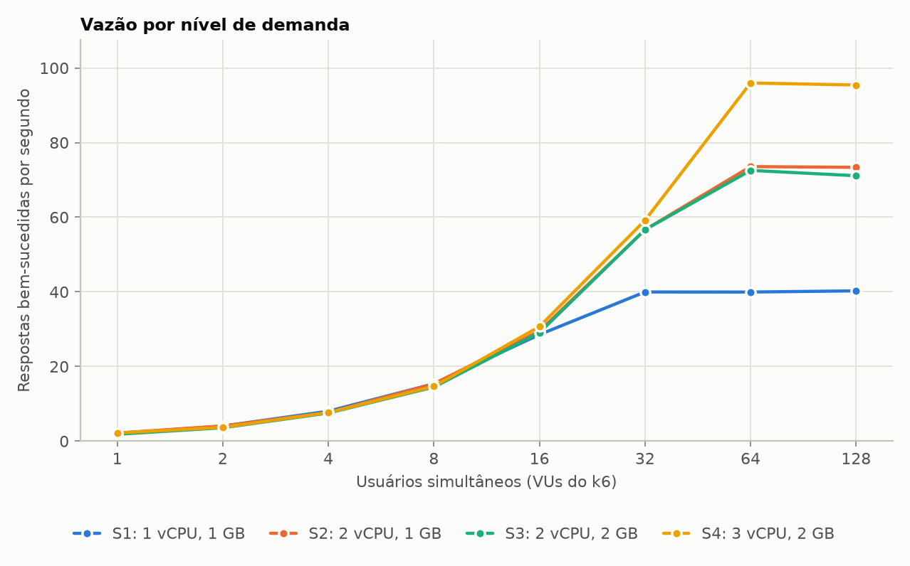
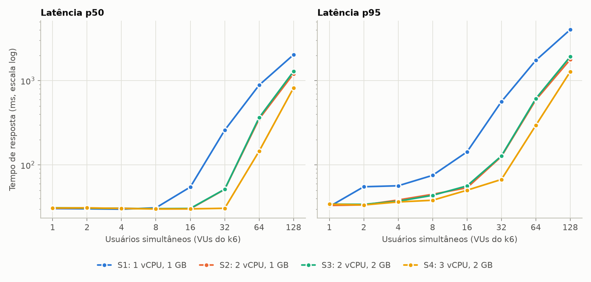
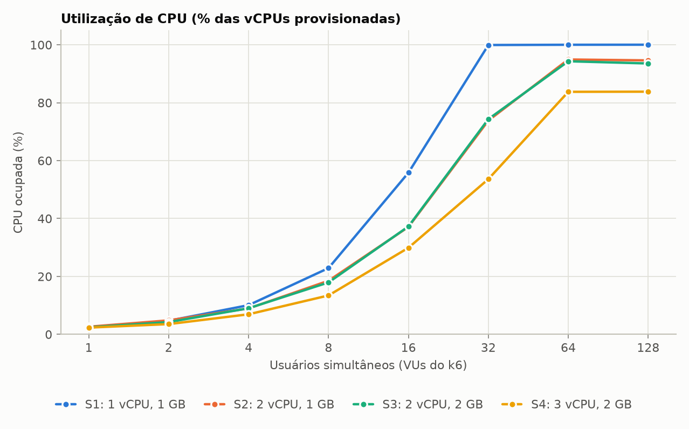
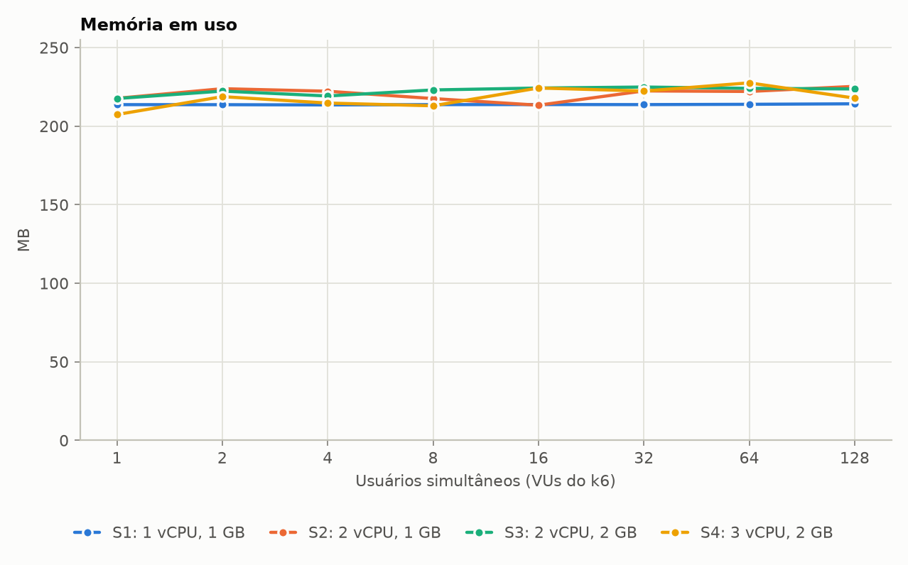
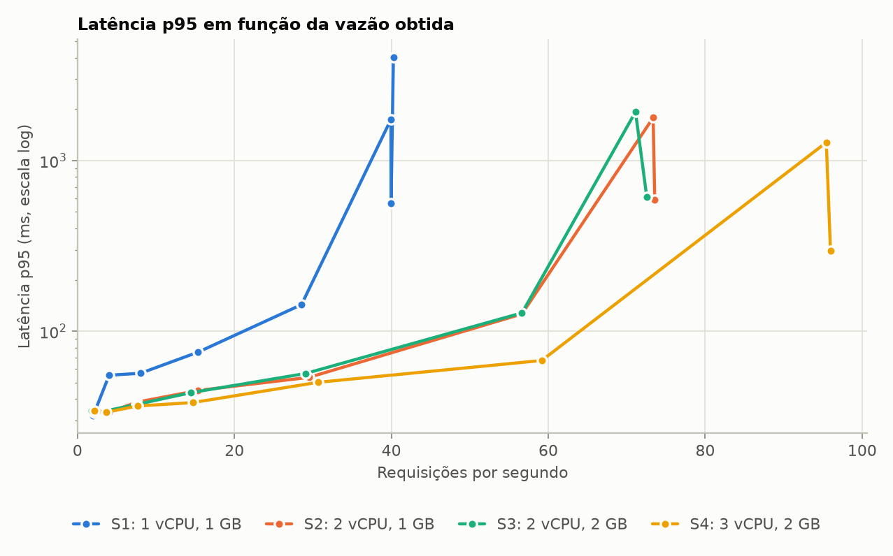

# Demanda, Provisionamento e Desempenho

Grupo: [PREENCHER: nome e matrícula de cada integrante]

Repositório: https://github.com/alcantarajulio/poi-atividade2

## 1. Aplicações desenvolvidas

As três aplicações são servidores HTTP em Go, escritos com a biblioteca padrão e o
cliente Prometheus. Todas têm a mesma estrutura: um endpoint principal que faz o
trabalho, `/livez` e `/readyz` para verificação de saúde, `/info` com o número de
CPUs que o processo enxerga e `/metrics` no formato Prometheus. O endpoint
principal recebe na query string os parâmetros que definem quanto trabalho cada
requisição faz, então dá para ajustar o tempo de serviço sem recompilar.

### 1.1 Aplicação CPU-bound (`cpu`, porta 8081)

`GET /cpu?iter=N` aplica o SHA-256 N vezes em cadeia, cada rodada sobre o
resultado da anterior. O cálculo é feito sobre 32 bytes que cabem em registradores
e cache, sem alocar memória nem acessar disco, e o tempo de resposta depende só
da CPU disponível. O custo cresce linearmente com N; na VM, N = [PREENCHER]
corresponde a cerca de [PREENCHER] ms por requisição. O runtime do Go distribui as
requisições entre todas as CPUs que o processo enxerga, então a aplicação usa
todas as vCPUs provisionadas.

### 1.2 Aplicação memory-bound (`mem`, porta 8082)

`GET /mem?mb=M&hold=H` aloca um buffer de M MB, escreve um byte em cada página de
4 KB para que o sistema operacional reserve memória física, percorre o buffer
lendo uma posição a cada 64 bytes (uma linha de cache) e o mantém alocado por H
milissegundos antes de responder. A varredura é limitada pela banda de memória.
O consumo total cresce com o número de requisições simultâneas: com c requisições
em andamento, o conjunto de trabalho fica perto de c × M. Nesta aplicação, a RAM
provisionada decide quando o sistema começa a usar swap ou mata o processo por
falta de memória (OOM).

### 1.3 Aplicação IO-bound (`io`, porta 8083)

`GET /io?kb=K` grava K KB num arquivo novo, chama `fsync` para forçar a escrita no
disco, lê o arquivo de volta e o apaga. O `fsync` só retorna quando o dispositivo
confirma a gravação, então a requisição passa a maior parte do tempo esperando o
disco, com a CPU ociosa. Com `fsync=0` os dados ficam só no cache de páginas do
kernel, o que permite comparar e isolar o custo do disco.

### 1.4 Caracterização local

Antes do laboratório, executamos e testamos as três aplicações numa máquina local
(MacBook com Apple M-series de 10 núcleos), em containers do Docker Desktop
limitados com `--cpus` e `--memory` no lugar da VM. A carga foi a mesma do
experimento principal: usuários do k6 com think time exponencial de média 0,5 s.
Os números confirmam o perfil de cada aplicação e serviram para calibrar
parâmetros e testar a coleta e a análise. Eles não se comparam diretamente com os
da VM, que roda em outro processador e outro hipervisor. As figuras e tabelas
completas estão em `docs/figuras/docker-cpu`, `docker-mem` e `docker-io`.

#### CPU-bound

Com `iter=500000`, cada requisição consome cerca de 29 ms de CPU, medidos pelo
próprio processo (CPU gasta dividida pelas requisições atendidas). A tabela compara
a vazão máxima prevista pela lei da utilização (CPUs / tempo de CPU por requisição)
com a medida:

| Configuração | Vazão máxima prevista (req/s) | Vazão máxima medida (req/s) | p95 passa de 2× o valor sem carga em |
|---|---|---|---|
| 1 CPU, 1 GB | 34 | 37 | 16 usuários |
| 2 CPUs, 1 GB | 70 | 76 | 32 usuários |
| 2 CPUs, 2 GB | 70 | 75 | 32 usuários |
| 4 CPUs, 2 GB | 135 | 136 | 128 usuários |

A vazão máxima dobra cada vez que as CPUs dobram. Com as mesmas 2 CPUs, a
configuração de 2 GB fica igual à de 1 GB. Nos cenários de 1 e 2 CPUs a vazão
medida passa um pouco da prevista porque, com carga leve, o macOS executa as
threads do Docker nos núcleos de eficiência, que são mais lentos. Isso aumenta o
tempo de CPU por requisição medido nos níveis baixos, e esse valor entra na
previsão.

#### Memory-bound

Com `mb=64&hold=200`, cada requisição segura 64 MB por 200 ms. Os dois testes usam
2 CPUs, um com 1 GB e outro com 2 GB de memória:

| Usuários | 1 GB: resp./s | 1 GB: erros | 1 GB: memória | 2 GB: resp./s | 2 GB: erros | 2 GB: memória |
|---|---|---|---|---|---|---|
| 1 | 1,5 | 0% | 139 MB | 1,3 | 0% | 151 MB |
| 4 | 5,0 | 0% | 279 MB | 5,8 | 0% | 299 MB |
| 16 | 21,1 | 0% | 878 MB | 22,6 | 0% | 904 MB |
| 32 | 13,0 | 66% | 943 MB | 42,9 | 5,6% | 1452 MB |
| 64 | 5,0 | 94% | 862 MB | 15,2 | 83% | 1631 MB |

A memória em uso cresce com a demanda até o limite provisionado. Com 1 GB, ela
chega perto do teto já com 16 usuários, e o p95 sobe de 214 para 557 ms. A partir
de 32 usuários o processo é morto por falta de memória e reiniciado várias vezes
seguidas, a vazão útil cai e a maior parte das requisições falha. Com 2 GB, o
colapso só aparece com 64 usuários. Diferente da aplicação de CPU, aqui é a RAM
que define a capacidade.

#### IO-bound

Com `kb=256` e `fsync`, uma requisição leva de 4 a 5 ms (p50), e só 1 a 2,5 ms
disso é CPU. A vazão acompanha a demanda até 64 usuários (125 respostas/s), o p95
fica estável em torno de 7 ms e a CPU do container não passa de 7%. O resto do
tempo de serviço é espera pela confirmação de escrita no disco. O disco virtual do
Docker Desktop é rápido e grava pelo cache do host, por isso a saturação não
aparece nessa faixa de demanda.

### 1.5 Monitoramento da aplicação e da infraestrutura

As métricas vêm de quatro pontos de observação. Os coletores ficam ligados só
durante cada nível de carga e são alinhados pela janela de medição do gerador de
carga.

O k6, no cliente, registra cada requisição e exporta por nível a vazão
(requisições por segundo), os percentis de latência (p50, p95, p99) e a taxa de
erros. É o desempenho percebido por quem usa o serviço.

Na aplicação, um coletor lê o endpoint `/metrics` a cada 2 segundos. Dali saem o
tempo de CPU consumido pelo processo, a memória residente (RSS), o heap do Go, o
número de requisições em andamento e um histograma da duração das requisições
medido pelo próprio servidor. A diferença entre a latência medida pelo servidor e
a medida pelo k6 é o tempo gasto em rede e em filas antes de a requisição chegar à
aplicação.

Dentro da VM, o `vmstat` registra uma amostra por segundo do sistema operacional
convidado (fila de execução, CPU em modo usuário, sistema, ociosa e esperando IO,
memória livre, buffers, cache e swap) e manda a saída ao host por ssh.

No host, a cada segundo, um coletor grava as métricas que o VirtualBox expõe para
a VM (`VBoxManage metrics query`) e lê de `/proc` o tempo de CPU e a memória do
processo do VirtualBox que executa a VM. Esses números mostram quanto a VM custa
ao host, seja qual for o estado dentro dela.

## 2. Configuração da VM e deploy da aplicação

### 2.1 Configuração da máquina virtual

[PREENCHER com os prints. Roteiro seguido: cópia do VDI
`ubuntu_server_2204_poi.vdi` de `/local/uasc/images` para `/tmp`; criação da VM
`poi-vm` no VirtualBox com pasta em `/tmp`, tipo Linux/Ubuntu 64-bit, 1 vCPU e
1 GB de RAM, usando o disco existente; boot e login; instalação e teste do nginx;
regras de redirecionamento de portas na interface NAT.]

Regras de redirecionamento usadas:

| Nome | Porta no host | Porta na VM | Uso |
|---|---|---|---|
| ssh | 2222 | 22 | deploy e coleta do `vmstat` |
| nginx | 8080 | 80 | teste do roteiro |
| cpu | 8081 | 8081 | aplicação CPU-bound |
| mem | 8082 | 8082 | aplicação memory-bound |
| io | 8083 | 8083 | aplicação IO-bound |

O nginx ficou na porta 8080 do host porque, no Linux, um usuário sem privilégios
não pode abrir portas abaixo de 1024, e o VirtualBox roda com o usuário do
laboratório.

### 2.2 Aplicação implantada

Escolhemos a aplicação CPU-bound para os testes de stress. A vazão dela depende só
da CPU, então o efeito de mudar o número de vCPUs aparece direto nas medições, e
um cenário que muda apenas a RAM serve de controle.

### 2.3 Etapas e requisitos do deploy

A aplicação é compilada no host de desenvolvimento para Linux x86-64 com
`CGO_ENABLED=0`, o que gera um binário estático. A VM não precisa de Go, de
bibliotecas nem de pacotes além do sistema base. O `deploy/deploy.sh` copia o
binário e a unit do systemd para a VM por ssh (porta 2222 do host) e executa
`deploy/vm-setup.sh` com sudo. Esse script cria um usuário de sistema sem login
(`poi`), instala o binário em `/opt/poi/bin` e habilita o serviço `poi-cpu`. O
systemd reinicia a aplicação se ela cair e a sobe a cada boot, então dá para
reconfigurar e religar a VM entre cenários sem intervenção manual.

O deploy precisa de acesso ssh por chave do host para a VM, das regras de
redirecionamento de portas e de permissão de sudo na VM para a instalação inicial.

[PREENCHER com prints: `systemctl status poi-cpu` na VM e `curl localhost:8081/info`
no host.]

## 3. Teste de stress da aplicação selecionada

### 3.1 Cenários de configuração de recursos

| Cenário | vCPUs | RAM | Objetivo |
|---|---|---|---|
| S1 | 1 | 1 GB | linha de base (configuração do roteiro) |
| S2 | 2 | 1 GB | efeito de dobrar a CPU |
| S3 | 2 | 2 GB | efeito de dobrar só a RAM, numa aplicação que não depende dela |
| S4 | [PREENCHER: 4 ou 3] | 2 GB | escalabilidade com mais vCPUs e limite do host |

O host do laboratório tem [PREENCHER: modelo da CPU, núcleos, threads e RAM, de
`experiments/results/vbox-cpu/host.txt`].

### 3.2 Como foram realizados os testes

O k6 gerou a carga na mesma máquina que hospeda a VM, fora dela, acessando a
aplicação pela porta redirecionada. Como o k6 também consome CPU do host, ele
disputa núcleos com a VM, e esse efeito deve aparecer mais no cenário com mais
vCPUs.

Cada usuário virtual envia uma requisição, espera a resposta, fica ocioso por um
tempo aleatório com distribuição exponencial de média 0,5 s (o "think time") e
envia a próxima. É um modelo de usuários interativos em laço fechado, e a demanda
é o número de usuários simultâneos, em oito níveis: 1, 2, 4, 8, 16, 32, 64 e 128.
Sem o think time, um único usuário já manteria uma vCPU ocupada o tempo todo, e
não haveria uma faixa sem saturação para comparar.

Cada nível dura 70 segundos: 10 de aquecimento, que são descartados, e 60 de
medição. O `experiments/run.sh` automatiza a sequência. Para cada cenário, ele
desliga a VM por ACPI, aplica `VBoxManage modifyvm --cpus --memory`, liga a VM em
modo headless, espera o `/readyz` responder, registra a configuração vista de
dentro da VM (`nproc`, `free -m`) e roda os oito níveis, com os coletores da seção
1.5 ligados só durante cada nível.

### 3.3 Resultados

[PREENCHER com as figuras de `docs/figuras/vbox-cpu/` e a tabela de
`docs/figuras/vbox-cpu/summary.md`.]

### 3.4 Interpretação e conclusões

[PREENCHER depois dos experimentos, respondendo às perguntas abaixo.]

[Em que nível de demanda cada cenário satura? A vazão para de crescer quando a CPU
chega perto de 100%, e daí em diante cada usuário a mais só aumenta a fila e a
latência. Comparar o nível de saturação medido com o previsto pelo modelo (N* na
tabela de capacidade).]

[Quanto a vazão máxima escala com as vCPUs? Comparar S1, S2 e S4 com a previsão
vCPUs / D, em que D é a CPU gasta por requisição. Se o S4 ficar abaixo do previsto,
discutir a disputa por CPU no host (gerador de carga na mesma máquina, núcleos
físicos versus threads).]

[Por que o S3 não difere do S2? A aplicação não usa mais memória com mais carga, e
a RAM extra fica ociosa. Aumentar um recurso que não é o gargalo não melhora o
desempenho.]

[A partir de qual nível o p95 passa do dobro do valor sem carga, em cada cenário?]
